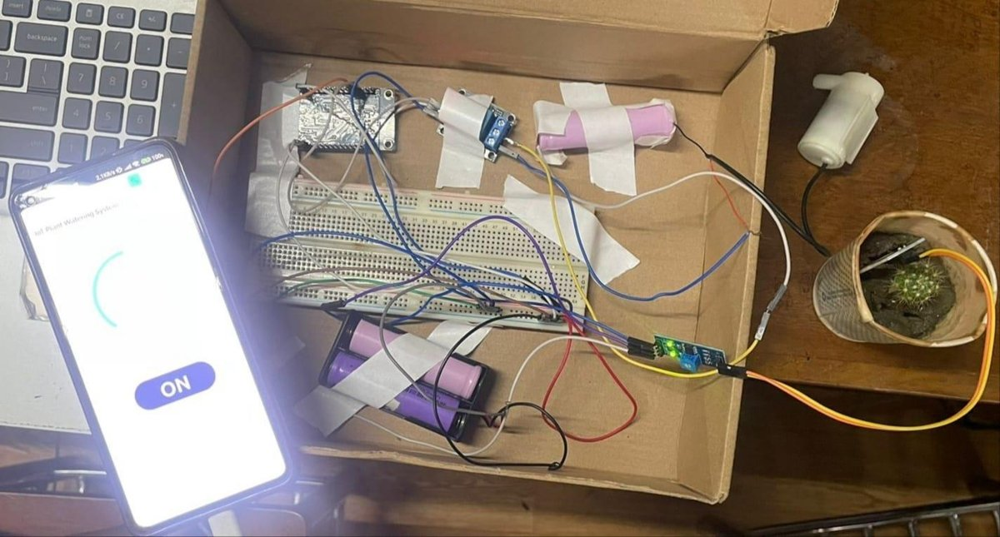
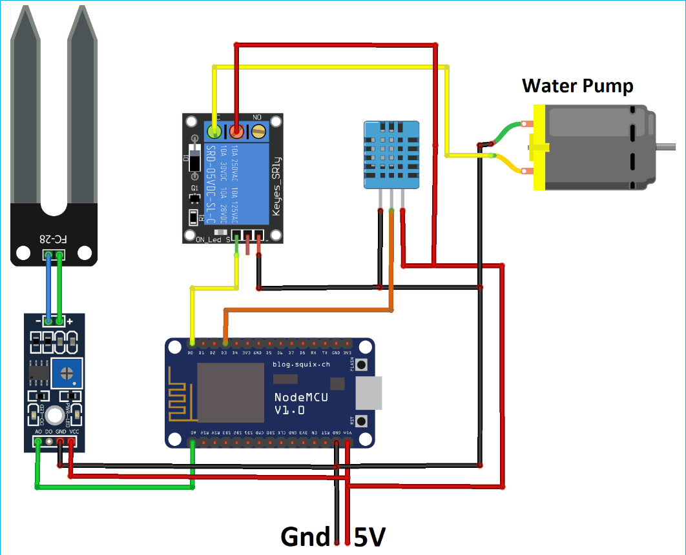
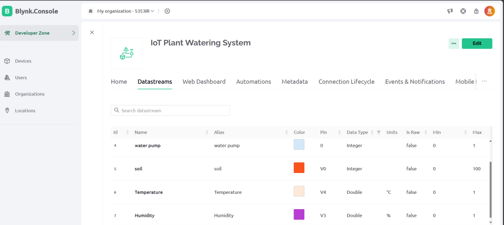
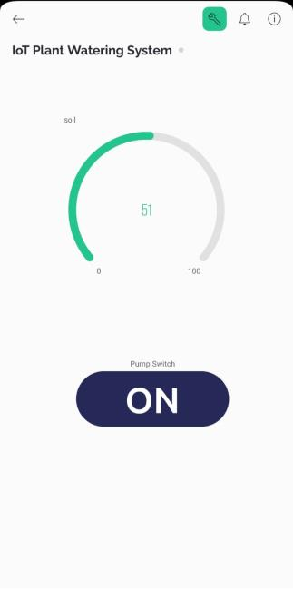

<h1 align="center">IoT Based Plant Watering System</h1>

<p align="center">
  Monitor soil moisture, temperature, and humidity from your phone, get alerts when a plant needs water, and switch the pump on remotely.
</p>

<p align="center">
  
  
  
</p>

<p align="center">
  
</p>

---

### About

Manual watering is easy to forget, and both under- and over-watering harm plants. This project connects a soil moisture sensor and a water pump to a NodeMCU ESP8266, which sends readings to the Blynk cloud. From the Blynk mobile app, the user can see the soil moisture, temperature, and humidity in real time, receive alerts when the soil is too dry or too wet, and turn the pump on or off from anywhere.

Built as a group project for **CSE-460: IoT Laboratory** at Jahangirnagar University (May 2024).

---

### Features

- **Live soil moisture** reading, shown as a percentage in the app
- **Temperature and humidity** from a DHT11 sensor
- **Alerts** when moisture drops below 25% ("Plant needs watering!") or rises above 40% ("Do not water the plant!")
- **Remote pump control** with an on/off button in the Blynk app

---

### Hardware

| Component | Quantity |
| --- | --- |
| NodeMCU ESP8266 | 1 |
| Soil moisture sensor (FC-28) | 1 |
| DHT11 temperature and humidity sensor | 1 |
| Single-channel relay module | 1 |
| 6V DC submersible pump with pipe | 1 |
| Breadboard and jumper wires | as needed |
| 3.7V rechargeable batteries | 2 |

**Pin connections**

| Signal | NodeMCU pin |
| --- | --- |
| Soil moisture sensor (analog out) | A0 |
| Relay (pump control) | D3 |
| DHT11 data | D4 |

<p align="center">
  
</p>

---

### Blynk setup

| Datastream | Virtual pin | Type |
| --- | --- | --- |
| Soil moisture (%) | V0 | Integer, 0 to 100 |
| Pump on/off button | V1 | Integer, 0 or 1 |
| Humidity (%) | V3 | Double |
| Temperature (°C) | V4 | Double |

Also create two events in Blynk named **"Plant needs watering!"** and **"Do not water the plant!"** so the alerts reach the app.

<p align="center">
  
  &nbsp;
  
</p>

---

### Getting started

1. Install the **Arduino IDE** and add ESP8266 board support.
2. Install the **Blynk** and **DHT sensor library** (Adafruit) libraries.
3. Open `firmware/plant_watering_system/plant_watering_system.ino`.
4. Replace `YOUR_TEMPLATE_ID`, `YOUR_BLYNK_AUTH_TOKEN`, `YOUR_WIFI_SSID`, and `YOUR_WIFI_PASSWORD` with your own values.
5. Select **NodeMCU 1.0 (ESP-12E Module)** as the board, then upload.

---

### Project structure

```
iot-plant-watering-system/
├── firmware/plant_watering_system/
│   └── plant_watering_system.ino   # ESP8266 firmware
├── images/                         # photos, circuit diagram, Blynk screenshots
└── README.md
```

---

### Team

Group 08, Department of CSE, Jahangirnagar University

- Nurun Nahar Fiha
- Umme Faria Moon
- Md Shagor Hossain

Supervised by **Dr. Md. Ezharul Islam**, Professor, Department of CSE, Jahangirnagar University.
